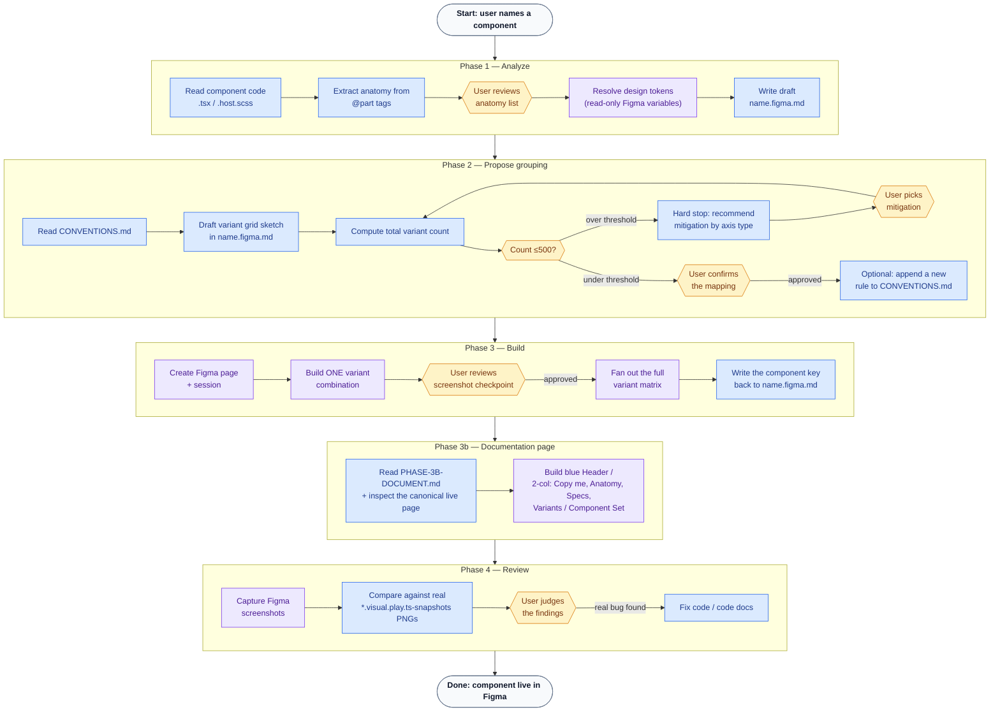

# ds-figma-component

Creates a Figma component (one dedicated page per component) from an existing Stencil
component's code. Code is always the source of truth — this skill never invents a hardcoded
value, a new design token, or a Figma-side detail that doesn't trace back to the component's
actual props, states, and resolvable design tokens.

**v1 scope — create-only.** This skill pushes a component into Figma for the first time. It does
not update or reconcile an already-pushed component, and it does not generate Code Connect
mappings (use the separate `figma-code-connect` skill for that, using this skill's output as
reference). See [`code-to-figma.md`](../../../code-to-figma.md) at the repo root for the full
background and rationale behind these decisions.

Load `figma-use` alongside this skill before any `use_figma` call (mandatory per that skill's own
rule). Load `figma-generate-library` for its guidance on binding values to Figma variables and
reusing existing components, since the same discipline applies here.

## Workflow at a glance



🔵 **code** — reads or writes a file in this repo (`.tsx`/`.scss`, `name.figma.md`, `CONVENTIONS.md`, test snapshots).
🟣 **figma** — a `use_figma`/`get_screenshot` call against the live Figma file.
🟡 **human** — a required stop-and-wait checkpoint; never assume approval and keep going.

The three human checkpoints (Phase 1's anatomy review, Phase 2's mapping confirmation, Phase 3's
first-variant screenshot) are the only places this skill pauses for a decision — everything else is
read/write work it does on its own between them.

## Prerequisites

- `figma.config.json` at the repo root must have a real `componentLibraryFileKey` (not the
  `REPLACE_WITH_FIGMA_FILE_KEY` placeholder). If it's still the placeholder, stop and ask the
  user for the file key before doing anything else.
- The target component must already exist in code (`packages/core/src/components/<category>/<name>/`).
- If the component nests another DS component (e.g. a button using an icon), the nested
  component's own `<child>.figma.md` must already exist and record a Figma component key. If it
  doesn't, stop and tell the user to run this skill on the child component first — do not
  recreate the child or fall back to a plain shape.

## Workflow

Each phase lives in its own file — read the current phase's file when you reach it, don't load
all five up front. Each file opens with a "you are here" line naming what the prior phase must
have produced, and closes with an explicit `Next:` pointer to the following file.

1. [`PHASE-1-ANALYZE.md`](PHASE-1-ANALYZE.md) — read the component's code (props, anatomy,
   pseudo-states, text attributes) and resolve every value to a Figma design token, hard-stopping
   on anything that can't be resolved. Writes the draft `<name>.figma.md`.
2. [`PHASE-2-PROPOSE.md`](PHASE-2-PROPOSE.md) — turn the draft into a concrete Figma
   variant-grouping proposal (variant vs. instance-swap vs. top-level split, grid sketch, 500-variant
   budget check) and get the user's explicit sign-off before anything is built.
3. [`PHASE-3-BUILD.md`](PHASE-3-BUILD.md) — build the real Figma `COMPONENT_SET` incrementally:
   one confirmed variant combination first, then fan out the rest.
4. [`PHASE-3B-DOCUMENT.md`](PHASE-3B-DOCUMENT.md) — build the per-component documentation page
   (header, Copy me, Anatomy, Specs, Variants, Component Set) from the fixed page template.
5. [`PHASE-4-REVIEW.md`](PHASE-4-REVIEW.md) — compare the built Figma output against real visual
   regression baselines and report findings; this is the last phase in this skill's v1 scope.

## Mapping file format

`<name>.figma.md` lives at `packages/core/src/components/<category>/<name>/<name>.figma.md`,
co-located with the component's other files. It's both the input spec you confirm in Phases 1–2
and the output record Phase 3 writes back into.

```markdown
# <name> → Figma mapping

\`\`\`yaml
figmaComponentKey: null # filled in by Phase 3 on success
figmaPage: <Name>

anatomy:

- letter: A
  part: label
  description: "The text label wrapper (<span>)."
- letter: B
  part: icon
  description: "The leading icon wrapper (or the brand icon wrapper when brandIcon is set)."

# Omit this whole `anatomy:` key if the component has no @part tags at all.

props:

- name: size
  type: enum
  options: [sm, base]
  figmaProperty: size
  figmaPropertyType: variant
- name: label
  type: string
  figmaProperty: null
  figmaPropertyType: instance-text-override
  states:
  figmaProperty: state
  options: [default, hover, focus, active, disabled]
  sources:
  hover: ":hover (spinner.host.scss)"
  disabled: "disabled prop"
  nested:
- childTag: ds-icon
  childMappingFile: ../icon/icon.figma.md
  figmaComponentKey: <resolved from icon.figma.md>
  tokens:
- cssVar: --ds-alias-background-color-sky
  figmaVariable: Alias/Background Color/Sky
  resolved: true
- cssVar: --ds-spinner-color-one-off
  figmaVariable: null
  resolved: false
  resolution: "<decision made with the user — pick a token or accept hardcoded>"
  specs: # one entry per option of the Variants axis, shown in Phase 3b's "📐 Specs" section
  base:
  - kind: size # size | icon | spacing | radius (| type, once added)
    label: Size # Size (width = height, same variable) | Width | Height | Min width | Min height | Padding | Gap | Radius | …
    px: 24
    token: 🧩 Component/Close/Size/Base # exact Figma variable name
  - kind: spacing
    label: Padding
    px: 5 # actual value used (marker + legend Value)
    token: 🧩 Component/Close/Padding/Base
    calc: '(10px) ÷ 2' # only when px is calculated from the variable; shown in the legend
    \`\`\`

Notes on this mapping, open questions, and rationale for any non-obvious grouping decision go
here as prose, below the YAML block.
```

## Notes

- This skill never commits — leave `<name>.figma.md`, `figma.config.json`, and
  `CONVENTIONS.md` changes unstaged for the user to review, same as every other skill in this
  repo.
- First real run target: `ds-spinner` (`packages/core/src/components/indicators/spinner/`).
- A hard stop (missing token, missing nested child mapping) is not a failure to work around —
  surface it and wait for the user's decision.

## See Also

- [`code-to-figma.md`](../../../code-to-figma.md) — the full plan and the reasoning behind every
  scope decision in this skill.
- [`CONVENTIONS.md`](CONVENTIONS.md) — accumulated mapping heuristics across components.
- `PHASE-1-ANALYZE.md` / `PHASE-2-PROPOSE.md` / `PHASE-3-BUILD.md` / `PHASE-3B-DOCUMENT.md` /
  `PHASE-4-REVIEW.md` — the full workflow, one file per phase (see "## Workflow" above).
- [`packages/tokens/CONTEXT.md`](../../../packages/tokens/CONTEXT.md) — token layers and naming.
- [`packages/core/CONTEXT.md`](../../../packages/core/CONTEXT.md) — component categories and
  structure.
