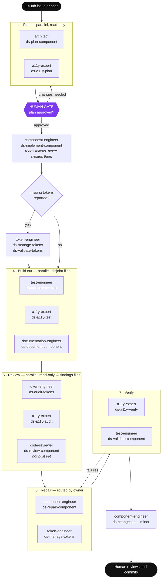
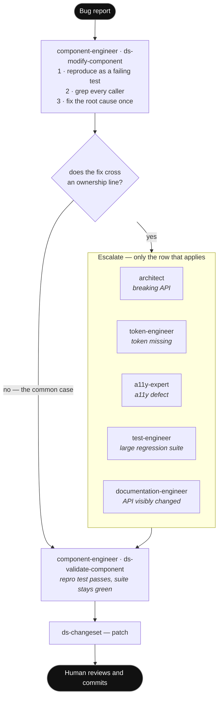
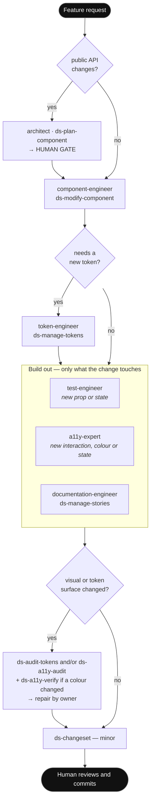
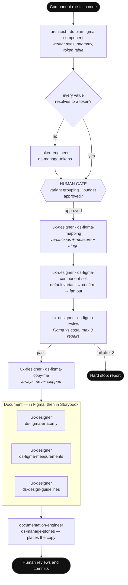

# DS Team — agents, skills and workflows

How the design system agents work together. The **orchestrator is the main session**, not an
agent — it dispatches the agents below and holds no component context of its own.

## The agents

| Agent                    | Model  | Writes                                                                                         | Read-only |
| ------------------------ | ------ | ---------------------------------------------------------------------------------------------- | :-------: |
| `architect`              | opus   | nothing — plans only                                                                           |     ✓     |
| `component-engineer`     | sonnet | `packages/core/src/components/**`, `index.ts`, `test/*.visual.html`, `test/*.style.html`       |           |
| `test-engineer`          | sonnet | `.spec.ts`, `.component.play.ts`, `.visual.play.ts`, `.ssr.play.ts`, `.variants.ts`, `*.po.ts` |           |
| `a11y-expert`            | opus   | `.a11y.play.ts`, keyboard/focus tests in `.component.play.ts`, a11y reports                    |           |
| `token-engineer`         | opus   | `packages/tokens/tokens/*.json`, token refs in SCSS                                            |           |
| `documentation-engineer` | sonnet | `apps/storybook/src/**`                                                                        |           |
| `ux-designer`            | opus   | the Figma file, `<name>.figma.md`, `<name>.figma-validation.md`                                |           |

File ownership is **disjoint by design** — that is what makes the parallel steps below safe.
An agent that finds a defect outside its own files reports it; it never reaches across.

**One carve-out — the judgment and the test that encodes it stay together.** An agent may add
tests to the component's _existing_ `.component.play.ts` or `.spec.ts` when the test only
exists because of that agent's own expertise:

| Agent              | May add                                          | Because                                                                 |
| ------------------ | ------------------------------------------------ | ----------------------------------------------------------------------- |
| component-engineer | the failing reproduction test for a bug it fixes | a fix and its pinning test are one unit of work                         |
| a11y-expert        | keyboard, focus-order and ARIA-state tests       | the APG keyboard contract is the a11y judgment, not a generic assertion |

Both write into test-engineer's files, deliberately. Writing the test is cheap; knowing _what
to assert_ is the expensive part, and handing a keyboard map to another agent to transcribe
loses the reason each key matters. test-engineer still owns the files and everything larger —
a new suite, a new file, a broad variant matrix, `.variants.ts`.

Keyboard tests go in `.component.play.ts`, not `.a11y.play.ts`: the axe fixture scans a static
tree, so it cannot press a key. That is the repo's existing split — 15 components keep keyboard
tests in `.component.play.ts`, one in `.a11y.play.ts`.

## Skill × agent matrix

`W` = owner (writes) · `R` = shared, read or run only · `—` = not available

| Skill                           | Arch | Comp-Eng | Test-Eng | A11y | Token-Eng | Docs-Eng | UX  |
| ------------------------------- | :--: | :------: | :------: | :--: | :-------: | :------: | :-: |
| `ds-plan-component`             |  W   |    —     |    —     |  —   |     —     |    —     |  —  |
| `ds-implement-component`        |  —   |    W     |    —     |  —   |     —     |    —     |  —  |
| `ds-modify-component`           |  —   |    W     |    —     |  —   |     —     |    —     |  —  |
| `ds-repair-component`           |  —   |    W     |    —     |  —   |     —     |    —     |  —  |
| `ds-lint-component`             |  —   |    W¹    |    —     |  —   |     —     |    —     |  —  |
| `ds-test-component`             |  —   |    —     |    W     |  —   |     —     |    —     |  —  |
| `ds-update-screenshots`         |  —   |    —     |    W²    |  —   |     —     |    —     |  —  |
| `ds-a11y-plan`                  |  —   |    —     |    —     |  W   |     —     |    —     |  —  |
| `ds-a11y-audit`                 |  —   |    —     |    —     |  W   |     —     |    —     |  —  |
| `ds-a11y-test`                  |  —   |    —     |    —     |  W   |     —     |    —     |  —  |
| `ds-a11y-verify`                |  —   |    —     |    —     |  W   |     —     |    —     |  —  |
| `ds-audit-tokens`               |  ³   |    —     |    —     |  —   |     W     |    —     |  —  |
| `ds-manage-tokens`              |  —   |    —     |    —     |  —   |     W     |    —     |  —  |
| `ds-manage-brand`               |  —   |    —     |    —     |  —   |     W     |    —     |  —  |
| `ds-document-component`         |  —   |    —     |    —     |  —   |     —     |    W     |  —  |
| `ds-manage-stories`             |  —   |    —     |    —     |  —   |     —     |    W     |  —  |
| `ds-document-guidelines`        |  —   |    —     |    —     |  —   |     —     |    W     |  —  |
| `ds-code-to-figma`              |  —   |    —     |    —     |  —   |     —     |    —     | R⁴  |
| `ds-plan-figma-component`       |  W   |    —     |    —     |  —   |     —     |    —     |  —  |
| `ds-figma-mapping`              |  —   |    —     |    —     |  —   |     —     |    —     |  W  |
| `ds-figma-component-set`        |  —   |    —     |    —     |  —   |     —     |    —     |  W  |
| `ds-figma-copy-me`              |  —   |    —     |    —     |  —   |     —     |    —     |  W  |
| `ds-figma-anatomy`              |  —   |    —     |    —     |  —   |     —     |    —     |  W  |
| `ds-figma-measurements`         |  —   |    —     |    —     |  —   |     —     |    —     |  W  |
| `ds-figma-review`               |  —   |    —     |    —     |  —   |     —     |    —     |  W  |
| `ds-design-guidelines`          |  —   |    —     |    —     |  —   |     —     |    —     |  W  |
| **`ds-validate-component`**     |  —   |    R     |    R     |  R   |     —     |    —     |  —  |
| **`ds-validate-tokens`**        |  —   |    R     |    R     |  —   |     R     |    —     |  —  |
| **`ds-validate-documentation`** |  —   |    —     |    —     |  —   |     —     |    W     |  —  |
| **`ds-changeset`**              |  —   |    R     |    —     |  —   |     R     |    —     |  —  |

¹ `--fix` writes — only the component-engineer may use that flag.
² user-invoked only; posts a PR comment. Never triggered proactively.
³ cannot run it (no Bash) — the architect **reads** an existing `<family>.token-check.md`.
⁴ the **mechanics reference** (`conventions/`, `PHASE-*.md`) the eight Figma skills above read
from; not run end-to-end any more.

**Rule:** a skill that writes has exactly one owner. A skill that only reads, reports or runs
checks can be shared with any agent whose tools can execute it.

## Handoff artifacts

Agents hand over **files, never prose**. This keeps the orchestrator's context small and makes
a run resumable.

| Artifact                              | Written by         | Read by                                 |
| ------------------------------------- | ------------------ | --------------------------------------- |
| `docs/plans/<component>-plan.md`      | orchestrator¹      | component-engineer, test-engineer, docs |
| `docs/plans/<component>-a11y-plan.md` | orchestrator¹      | component-engineer, test-engineer       |
| `test/<name>.visual.html`             | component-engineer | **human review**, test-engineer         |
| `<family>.token-check.md`             | token-engineer     | token-engineer, architect               |
| a11y audit findings                   | a11y-expert        | component-engineer                      |
| `<name>.figma.md`                     | ux-designer        | ux-designer, next family that nests it  |
| `<name>.figma-validation.md`          | ux-designer        | ux-designer, component-engineer         |
| anatomy + do's/don'ts copy            | ux-designer        | documentation-engineer                  |

¹ The architect is read-only and has no `Write` tool, so it **returns** its plan rather than
saving it. The orchestrator writes the returned plan to `docs/plans/` before the approval gate
and dispatches the next step with that path. Same for the a11y plan — step 1 is read-only on
both sides, which is what makes the two planners safe to run in parallel.

---

# Workflow A — New component

Full pipeline. Use for a new component or a breaking change.



**1 · Plan** — `ds-plan-component` ∥ `ds-a11y-plan`. Both read-only, no shared writes. The
keyboard map does not depend on the prop list, so these genuinely run at the same time.

> **Gate.** A human approves the plan before any code is written. The engineer must not
> design the component itself.

**2 · Implement** — `ds-implement-component`. Writes component source, the `index.ts`
export, and `test/<name>.visual.html` (plus `.style.html` for a CSS-only/hybrid component).
Creates an _empty_ Storybook folder and generates no tests. It **reads tokens and
never creates them**: a missing token is referenced by the name it should have, with no
fallback and nothing hardcoded, and reported as a blocking handoff.

**3 · Tokens** — only if step 2 reported missing tokens. `ds-manage-tokens` →
`ds-validate-tokens`. The token-engineer owns the final name and reports any it corrected so
the engineer's SCSS reference can follow.

> **Gate — a human looks at the component.** Run `pnpm start` and open
> `/components/<category>/<name>/test/<name>.visual.html`. Every variant, state and size is on
> that one page because the engineer built it that way. Approve it before any test is written:
> a screenshot baseline taken over an unreviewed component bakes the bug into the baseline, and
> every later visual run then defends it.

**4 · Build out — parallel.** Three agents, three disjoint file sets:

| Agent                  | Skill                   | Writes                             |
| ---------------------- | ----------------------- | ---------------------------------- |
| test-engineer          | `ds-test-component`     | unit, interaction, visual, SSR, PO |
| a11y-expert            | `ds-a11y-test`          | `.a11y.play.ts` only               |
| documentation-engineer | `ds-document-component` | `apps/storybook/src/**`            |

`ds-test-component` **reads** the approved fixture and writes the variant list from it:

```
test/<name>.visual.html        ← component-engineer, human-approved
  └─ test/<name>.variants.ts   → TAG + HOST_VARIANTS
       ├─ .visual.play.ts      (host suite)
       └─ .ssr.play.ts         (same variants, same baselines)
```

One list, two suites — the SSR test calls `visualBaseline(TAG)`, so it compares against the
_visual_ test's snapshots. That is why both must iterate the same `HOST_VARIANTS`: a variant
added to one and not the other produces a missing-baseline failure rather than a diff.

`.ssr.play.ts` is generated only when the component has a `.host.scss` — a CSS-only component
renders as plain classed HTML with no shadow root to hydrate, so there is nothing for an SSR
test to assert (`form`, `link`, `table`, `grid`, `picture`, `time-input` have none).

It writes neither the fixture nor `.a11y.play.ts`, and it errors out if the fixture is missing,
which keeps the gate above from being skipped.

**5 · Review — parallel, read-only.** `ds-audit-tokens` ∥ `ds-a11y-audit`. Both produce
findings files and converge on one repair round. (A `code-reviewer` agent joins here once
`ds-review-component` exists.)

**6 · Repair** — route findings by owner: source → component-engineer (`ds-repair-component`),
tokens → token-engineer (`ds-manage-tokens`). Both verify each finding before acting; an
invalid finding is reported as `INVALID` with its reason, not silently applied.

**7 · Verify** — `ds-a11y-verify` for per-criterion WCAG sign-off, `ds-validate-component` for
the suites. Report axe-clean and WCAG 2.2 AA conformance as separate claims.

**8 · Ship** — `ds-changeset`, minor. Everything is left **unstaged**; the human commits.

---

# Workflow B — Bug fix

**The escape hatch. One agent, no pipeline.** Routing a one-line fix through eight phases is
how a team like this gets abandoned.



`ds-modify-component` reproduces the defect as a failing test first, greps every caller before
editing anything shared, and fixes the root cause once.

**Escalate only when the fix crosses an ownership line:**

| Trigger                                        | Add                                                         |
| ---------------------------------------------- | ----------------------------------------------------------- |
| Breaking public API change                     | architect — needs an approved plan first                    |
| A needed token does not exist                  | token-engineer                                              |
| The fix needs an **a11y decision** or sign-off | a11y-expert — audits and verifies; the engineer still fixes |
| A new suite, new test file, or variant matrix  | test-engineer                                               |
| The fix adds a `visual.html` section           | test-engineer — must regenerate `.variants.ts`              |
| Public API or behavior visibly changed         | documentation-engineer                                      |

Default to no escalation. Add an agent because the work crosses into its files, not because
the pipeline has a slot for it.

**A bug with an a11y dimension is still a bug.** The a11y-expert writes tests and findings; it
never edits component source. Escalate when the _decision_ is an a11y one — which ARIA
attribute, which APG pattern, whether a disabled control should stay focusable — not merely
because the symptom touches accessibility. Fixing a click handler that ignores `disabled`
needs no escalation; deciding between native `disabled` and `aria-disabled` does, because
that changes whether assistive tech can still find the control.

**When the report is already an a11y defect, the audit comes first.** The diagram's
fix-then-escalate order assumes the engineer can see the correct behaviour. For "keyboard
navigation is broken in select" it cannot: what Arrow/Home/End/Escape/type-ahead _should_ do
comes from the APG Combobox pattern, not from reading the current code. Run it in this order
instead:

1. **a11y-expert · `ds-a11y-audit`** — which keys are missing or wrong, against the named APG
   pattern, as findings with `file:line`. Read-only.
2. **component-engineer · `ds-repair-component`** — fixes from that findings file, verifying
   each finding before acting. `ds-repair-component`, not `ds-modify-component`: the work
   starts from findings and reports a per-finding `RESOLVED` / `INVALID` / `BLOCKED` status.
3. **a11y-expert · `ds-a11y-test`** — one keyboard test per row of the corrected map, in
   `.component.play.ts` (see the carve-out above).
4. **a11y-expert · `ds-a11y-verify`** — per-criterion sign-off. Keyboard operability of a
   custom widget is one of the things axe cannot check, so this step is the only evidence.

Fixing first and auditing after means the engineer invents a keyboard contract and the audit
then disputes it — two rounds of work and a plausible-but-wrong interaction model in between.

---

# Workflow C — Feature on an existing component

Between A and B. Additive change to a component that already ships.



`ds-modify-component`, not `ds-implement-component` — backward compatibility and impact
assessment are the point. A new prop reaches stories (`ds-manage-stories`) and tests; a new
visual state reaches tokens too.

**"Public API changes?" means a new prop, event, method or slot** — those need the architect
and the gate. **Adding a value to an existing enum does not.** Widening `BADGE_COLORS` is
additive, has one obvious shape, and goes straight to the engineer. Sending it through a plan
and a human gate is the same over-routing Workflow B exists to avoid.

**A new enum value fans out further than it looks.** For a new badge color, every one of these
is a separate owner's file:

| Artifact                                             | Owner                                        |
| ---------------------------------------------------- | -------------------------------------------- |
| `BADGE_COLORS` + `.host.scss` variant class          | component-engineer                           |
| `Component.Badge.<Color>.Color.Text` / `.Background` | token-engineer (`ds-manage-tokens`)          |
| the new swatch in `test/badge.visual.html`           | component-engineer                           |
| the `COLORS` array in `test/badge.a11y.play.ts`      | **a11y-expert** — contrast is the risk       |
| the story / `Variants` page                          | documentation-engineer (`ds-manage-stories`) |

**A new color always reaches the a11y-expert**, even though no interaction changed. A colour
pair is a contrast claim: text ≥ 4.5:1, UI ≥ 3:1, in the normal _and_ inverted rendering. The
`S3` trigger for a11y is therefore "new interaction **or new colour/state**", and the review
step must include `ds-a11y-verify`, not only `ds-a11y-audit` — the audit reads source and
cannot resolve a token chain to a computed ratio, so it will correctly report contrast as
`NOT_VERIFIED` and nothing else will check it.

Where the colour must also exist in Figma, `ds-code-to-figma` is a separate user-invoked run
after the tokens land.

---

# Workflow D — Component into Figma

Mirror a shipped component into the Figma library. Runs **after** the component exists in code;
it never leads.



**1 · Plan** — `ds-plan-figma-component`. Read-only, code-side only. Note what this does _not_
need: resolving a CSS var to a Figma variable id requires **no Figma access**, because
`scripts/figma-sync` already backfilled those ids into `Base.tokens.json`
(ADR-0017). The architect's real limits are different — no Bash (cannot measure on the dev
server) and no Write (cannot create the mapping file), which is why step 3 exists.

**2 · Tokens first.** A value with no token behind it is a hard stop, not a hardcoded Figma
value. Figma cannot represent an untokenized value without lying about it, and a hardcode will
not follow the next token change.

> **Gate.** A human approves the variant grouping and the variant count before anything is
> built. Figma's ceiling is 500 variants per set, and discovering the overrun mid-build is the
> expensive place to find it.

**3 · Map** — `ds-figma-mapping` creates `<name>.figma.md`: resolves every CSS var to its Figma
variable **id** locally (the ids are already in `Base.tokens.json`; never enumerate Figma's
1,900+ variables to answer "does this exist"), records the anatomy and nested component keys,
then measures the rendered component and gets the measurements triage confirmed. This file is
the contract every later step reads.

**4 · Build** — `ds-figma-component-set`. The default variant is built and approved **alone**
before the fan-out: a wrong binding replicated across 200 variants is 200 fixes.

**5 · Review** — `ds-figma-review`. The enum check runs in **both directions** — "Figma has
every code value" and "code has every Figma value" fail on different changes. Repairs Figma, not
code; a code-side defect is a finding for the component-engineer or token-engineer.

**6 · Copy me** — `ds-figma-copy-me`, always. Unlike Anatomy it is never conditional: one
unmodified instance of the default variant, which is the thing a designer actually drags out.

**7 · Document.** Anatomy and Measurements are built in Figma; `ds-design-guidelines` writes the
do's/don'ts and anatomy copy but **places nothing** — `apps/storybook/src/**` is the
documentation-engineer's. The per-part description is written once, in `ds-figma-anatomy`, and
reused verbatim in Storybook so the two surfaces cannot drift.

**Re-run `ds-figma-review` when the code changes.** A new prop, a new enum value or a renamed
token silently makes the Figma component a lie, and Figma has no test suite to catch it. A
library that drifts is worse than no library, because designers trust it.

---

## Rules that hold in every workflow

- **No agent commits, pushes or merges.** Changes are left unstaged for human review.
- **Visual baselines are approved by a human.** A failing visual test is reported as a diff;
  `ds-update-screenshots` is user-invoked only. Never `pnpm play:update`.
- **Evidence or it didn't happen.** "Tests pass" without the output is not a result. A check
  that didn't run is named, with the reason.
- **Never weaken, skip or delete a test** to make a suite pass.
- **Source beats docs.** Where `CONTEXT.md`, an ADR or a doc page disagrees with the code, the
  code wins and the doc gets fixed.
- **Pipe long output to a file and read the tail.** A full Stencil or Playwright run does not
  belong in an agent's context.
- Agents run in parallel **only** within the fan-out steps above, where file sets are disjoint.
  Two agents never write the same file.
