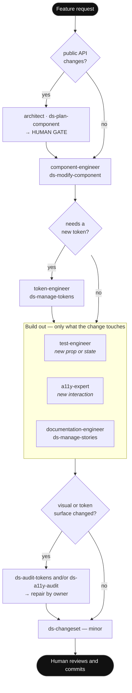

# DS Team — agents, skills and workflows

How the design system agents work together. The **orchestrator is the main session**, not an
agent — it dispatches the agents below and holds no component context of its own.

## The agents

| Agent                    | Model  | Writes                                                                                   | Read-only |
| ------------------------ | ------ | ---------------------------------------------------------------------------------------- | :-------: |
| `architect`              | opus   | nothing — plans only                                                                     |     ✓     |
| `component-engineer`     | sonnet | `packages/core/src/components/**`, `index.ts`, `test/*.visual.html`, `test/*.style.html` |           |
| `test-engineer`          | sonnet | `.spec.ts`, `.component.play.ts`, `.visual.play.ts`, `*.po.ts`                           |           |
| `a11y-expert`            | opus   | `.a11y.play.ts`, a11y reports                                                            |           |
| `token-engineer`         | opus   | `packages/tokens/tokens/*.json`, token refs in SCSS                                      |           |
| `documentation-engineer` | sonnet | `apps/storybook/src/**`                                                                  |           |

File ownership is **disjoint by design** — that is what makes the parallel steps below safe.
An agent that finds a defect outside its own files reports it; it never reaches across.

## Skill × agent matrix

`W` = owner (writes) · `R` = shared, read or run only · `—` = not available

| Skill                           | Arch | Comp-Eng | Test-Eng | A11y | Token-Eng | Docs-Eng |
| ------------------------------- | :--: | :------: | :------: | :--: | :-------: | :------: |
| `ds-plan-component`             |  W   |    —     |    —     |  —   |     —     |    —     |
| `ds-implement-component`        |  —   |    W     |    —     |  —   |     —     |    —     |
| `ds-modify-component`           |  —   |    W     |    —     |  —   |     —     |    —     |
| `ds-repair-component`           |  —   |    W     |    —     |  —   |     —     |    —     |
| `ds-lint-component`             |  —   |    W¹    |    —     |  —   |     —     |    —     |
| `ds-test-component`             |  —   |    —     |    W     |  —   |     —     |    —     |
| `ds-update-screenshots`         |  —   |    —     |    W²    |  —   |     —     |    —     |
| `ds-a11y-plan`                  |  —   |    —     |    —     |  W   |     —     |    —     |
| `ds-a11y-audit`                 |  —   |    —     |    —     |  W   |     —     |    —     |
| `ds-a11y-test`                  |  —   |    —     |    —     |  W   |     —     |    —     |
| `ds-a11y-verify`                |  —   |    —     |    —     |  W   |     —     |    —     |
| `ds-audit-tokens`               |  ³   |    —     |    —     |  —   |     W     |    —     |
| `ds-manage-tokens`              |  —   |    —     |    —     |  —   |     W     |    —     |
| `ds-manage-brand`               |  —   |    —     |    —     |  —   |     W     |    —     |
| `ds-document-component`         |  —   |    —     |    —     |  —   |     —     |    W     |
| `ds-manage-stories`             |  —   |    —     |    —     |  —   |     —     |    W     |
| `ds-document-guidelines`        |  —   |    —     |    —     |  —   |     —     |    W     |
| `ds-code-to-figma`              |  —   |    —     |    —     |  —   |     ⁴     |    —     |
| **`ds-validate-component`**     |  —   |    R     |    R     |  R   |     —     |    —     |
| **`ds-validate-tokens`**        |  —   |    R     |    R     |  —   |     R     |    —     |
| **`ds-validate-documentation`** |  —   |    —     |    —     |  —   |     —     |    W     |
| **`ds-changeset`**              |  —   |    R     |    —     |  —   |     R     |    —     |

¹ `--fix` writes — only the component-engineer may use that flag.
² user-invoked only; posts a PR comment. Never triggered proactively.
³ cannot run it (no Bash) — the architect **reads** an existing `<family>.token-check.md`.
⁴ unassigned today; user-invoked and needs the Figma MCP.

**Rule:** a skill that writes has exactly one owner. A skill that only reads, reports or runs
checks can be shared with any agent whose tools can execute it.

## Handoff artifacts

Agents hand over **files, never prose**. This keeps the orchestrator's context small and makes
a run resumable.

| Artifact                              | Written by         | Read by                                 |
| ------------------------------------- | ------------------ | --------------------------------------- |
| `docs/plans/<component>-plan.md`      | orchestrator¹      | component-engineer, test-engineer, docs |
| `docs/plans/<component>-a11y-plan.md` | orchestrator¹      | component-engineer, test-engineer       |
| `test/<name>.visual.html`             | component-engineer | **human review**, test-engineer         |
| `<family>.token-check.md`             | token-engineer     | token-engineer, architect               |
| a11y audit findings                   | a11y-expert        | component-engineer                      |

¹ The architect is read-only and has no `Write` tool, so it **returns** its plan rather than
saving it. The orchestrator writes the returned plan to `docs/plans/` before the approval gate
and dispatches the next step with that path. Same for the a11y plan — step 1 is read-only on
both sides, which is what makes the two planners safe to run in parallel.

---

# Workflow A — New component

Full pipeline. Use for a new component or a breaking change.

**1 · Plan** — `ds-plan-component` ∥ `ds-a11y-plan`. Both read-only, no shared writes. The
keyboard map does not depend on the prop list, so these genuinely run at the same time.

> **Gate.** A human approves the plan before any code is written. The engineer must not
> design the component itself.

**2 · Implement** — `ds-implement-component`. Writes component source, the `index.ts`
export, and `test/<name>.visual.html` (plus `.style.html` for a CSS-only/hybrid component).
Creates an _empty_ Storybook folder and generates no tests. It **reads tokens and
never creates them**: a missing token is referenced by the name it should have, with no
fallback and nothing hardcoded, and reported as a blocking handoff.

**3 · Tokens** — only if step 2 reported missing tokens. `ds-manage-tokens` →
`ds-validate-tokens`. The token-engineer owns the final name and reports any it corrected so
the engineer's SCSS reference can follow.

> **Gate — a human looks at the component.** Run `pnpm start` and open
> `/components/<category>/<name>/test/<name>.visual.html`. Every variant, state and size is on
> that one page because the engineer built it that way. Approve it before any test is written:
> a screenshot baseline taken over an unreviewed component bakes the bug into the baseline, and
> every later visual run then defends it.

**4 · Build out — parallel.** Three agents, three disjoint file sets:

| Agent                  | Skill                   | Writes                        |
| ---------------------- | ----------------------- | ----------------------------- |
| test-engineer          | `ds-test-component`     | unit, interaction, visual, PO |
| a11y-expert            | `ds-a11y-test`          | `.a11y.play.ts` only          |
| documentation-engineer | `ds-document-component` | `apps/storybook/src/**`       |

`ds-test-component` **reads** the approved fixture — its `<section data-testid="…">` values
become the `VARIANTS` array in `.visual.play.ts`. It writes neither the fixture nor
`.a11y.play.ts`, and it errors out if the fixture is missing, which keeps the gate above from
being skipped.

**5 · Review — parallel, read-only.** `ds-audit-tokens` ∥ `ds-a11y-audit`. Both produce
findings files and converge on one repair round. (A `code-reviewer` agent joins here once
`ds-review-component` exists.)

**6 · Repair** — route findings by owner: source → component-engineer (`ds-repair-component`),
tokens → token-engineer (`ds-manage-tokens`). Both verify each finding before acting; an
invalid finding is reported as `INVALID` with its reason, not silently applied.

**7 · Verify** — `ds-a11y-verify` for per-criterion WCAG sign-off, `ds-validate-component` for
the suites. Report axe-clean and WCAG 2.2 AA conformance as separate claims.

**8 · Ship** — `ds-changeset`, minor. Everything is left **unstaged**; the human commits.

---

# Workflow B — Bug fix

**The escape hatch. One agent, no pipeline.** Routing a one-line fix through eight phases is
how a team like this gets abandoned.

`ds-modify-component` reproduces the defect as a failing test first, greps every caller before
editing anything shared, and fixes the root cause once.

**Escalate only when the fix crosses an ownership line:**

| Trigger                                | Add                                      |
| -------------------------------------- | ---------------------------------------- |
| Breaking public API change             | architect — needs an approved plan first |
| A needed token does not exist          | token-engineer                           |
| The defect is an accessibility failure | a11y-expert (audit → fix → verify)       |
| Substantial regression coverage needed | test-engineer                            |
| Public API or behavior visibly changed | documentation-engineer                   |

Default to no escalation. Add an agent because the work crosses into its files, not because
the pipeline has a slot for it.

---

# Workflow C — Feature on an existing component

Between A and B. Additive change to a component that already ships.

`ds-modify-component`, not `ds-implement-component` — backward compatibility and impact
assessment are the point. A new prop reaches stories (`ds-manage-stories`) and tests; a new
visual state reaches tokens too.

---

## Rules that hold in every workflow

- **No agent commits, pushes or merges.** Changes are left unstaged for human review.
- **Visual baselines are approved by a human.** A failing visual test is reported as a diff;
  `ds-update-screenshots` is user-invoked only. Never `pnpm play:update`.
- **Evidence or it didn't happen.** "Tests pass" without the output is not a result. A check
  that didn't run is named, with the reason.
- **Never weaken, skip or delete a test** to make a suite pass.
- **Source beats docs.** Where `CONTEXT.md`, an ADR or a doc page disagrees with the code, the
  code wins and the doc gets fixed.
- **Pipe long output to a file and read the tail.** A full Stencil or Playwright run does not
  belong in an agent's context.
- Agents run in parallel **only** within the fan-out steps above, where file sets are disjoint.
  Two agents never write the same file.
